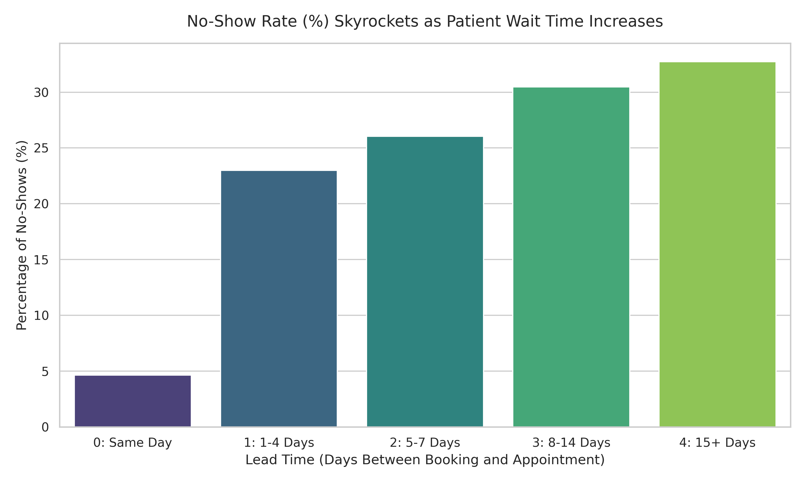
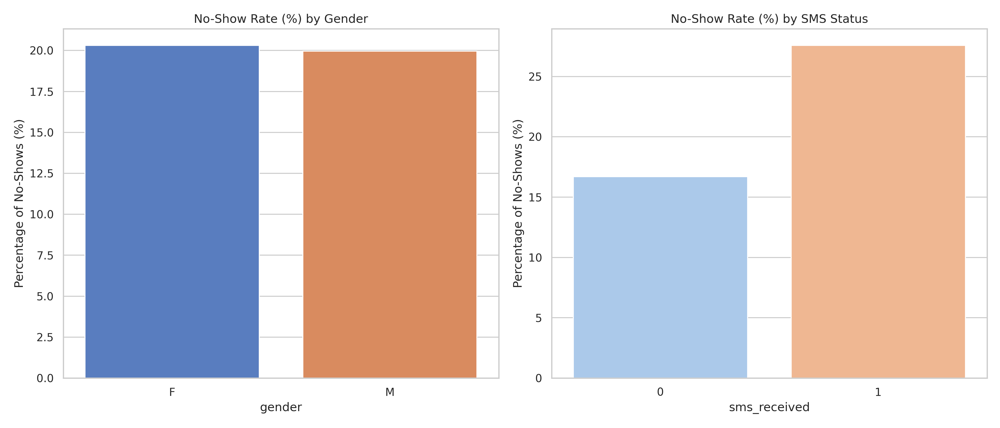

# 🏥 Patient No-Show Analysis: Optimizing Clinic Scheduling Efficiency

## 📋 Executive Summary
This project analyzes **110,000+ medical appointment records** to help a large hospital system understand why patients fail to show up for scheduled visits. While text reminders are traditionally assumed to increase attendance, this analysis revealed a major counterintuitive trend: **patients who received an SMS reminder missed their appointments at a far higher rate (27.57%) than those who did not (16.70%)**. 

By engineering a new metric, `lead_time`, I uncovered the true driving force: the hospital system only sends text reminders for long-range appointments, and **extreme wait times (15+ days) are the actual cause behind a 30%+ patient no-show rate**, causing massive operational waste.

---

## 🛠️ Technical Stack & Approach
* **Language:** Python
* **Libraries:** Pandas (Data Cleaning & Feature Engineering), Seaborn & Matplotlib (Data Visualization), NumPy
* **Environment:** Google Colab / Jupyter Notebooks

### Data Cleaning Checklist Accomplished:
* Fixed structural database typos (`Hipertension` ➡️ `Hypertension`; `Handcap` ➡️ `Handicap`).
* Standardized mixed casing column names into strict `snake_case`.
* Converted date parameters from text objects into true operational `datetime64` data types.
* Audited and removed data anomalies (dropped impossible negative patient ages and 5 scheduling entry errors).

---

## 📊 Key Findings & Data Visualizations

### 1. The Confounding Variable: Wait Time (Lead Time)
Initially, the data suggested that SMS reminders were correlated with higher no-show rates. By calculating the exact number of days between the scheduling booking and the actual appointment date, the true trend emerged:

* **No SMS group:** Average wait time was only **6.0 days** (Low no-show baseline).
* **SMS Received group:** Average wait time was **19.0 days** (High no-show baseline).

As visual proof below, as patient wait times increase past a week, no-show rates skyrocket exponentially regardless of text reminders:

### 2. Demographics & Reminders Overview
Gender proved to be an analytical dead end—both men and women miss appointments at a nearly identical ~20% baseline rate. 

---

## 💡 Strategic Recommendations for Clinic Management
1. **Implement Dynamic Scheduling:** Prioritize booking high-risk chronic care checkups within a strict 4-day window to keep no-show rates under 15%.
2. **Optimize the Reminder Protocol:** Instead of a generic automated SMS text days in advance, transition to a "Confirmation Required" SMS 48 hours prior for any appointment with a lead time exceeding 7 days. If unconfirmed, release the slot to same-day walk-ins.
3. **Overbook Predictively:** Safely overbook time slots that have a lead time of 15+ days by 25%, as historical data proves nearly 1 in 3 of these patients will result in a cancellation or no-show.

